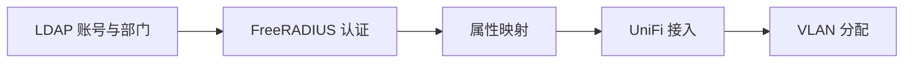

# 统一身份驱动的无线接入集成 · 工程导读

通过 LDAP 管理账号，通过 RADIUS 完成网络认证，并以组织属性控制 VLAN 分配，减少账号与无线接入策略的割裂。

## 先理解核心流程



## 值得深入的设计

- Go-Ldap-Admin、MySQL、OpenLDAP 与 FreeRADIUS 通过 Compose 组织，UniFi 作为外部网络接入设备。
- 身份验证和 VLAN 授权是两个阶段，应先验证账号可认证，再验证返回属性是否被 UniFi 接收。
- 认证配置挂载到本地目录，容器启动和配置准备有先后关系，不能只检查容器是否在运行。

## 沿源码验证能力

1. **[服务编排](../docker-compose.yml)**：沿此入口检查实际实现与调用关系。
2. **[配置截图](../assets)**：沿此入口检查实际实现与调用关系。

## 最短运行路线

以下为仓库既有脚本或配置对应的命令。命令以类 Unix Shell 为例，在仓库根目录执行；先准备所需服务和配置，不代表本次文档修改已经完成运行验证。

```bash
# 先检查并替换 Compose 中的密码与本地目录配置
docker compose config
docker compose up -d go-ldap-admin mysql openldap
# 按 README 准备 freeradius/config，再启动 Radius
docker compose up -d freeradius
```

## 一次演示应验证什么

1. FreeRADIUS 使用 host 网络及 ./freeradius/config 挂载；需要 Linux 网络环境与完整配置目录。
2. 先用测试用户验证 LDAP 查询，再通过 radtest 和 RADIUS Debug 定位认证失败阶段。
3. 最后验证 UniFi 上的 VLAN 下发与终端实际网络位置，不能仅凭认证成功判断授权正确。

## 当前边界与复现条件

- 仓库主要提供部署与集成说明，不将第三方服务功能归为自研实现。
- 密码存储方案需匹配所选 EAP / 内部认证协议；不要将明文密码配置作为通用部署建议。
- 证书有效期应按组织策略管理，不能仅通过延长有效期替代证书验证和轮换。

## 继续贡献

建议从最小可复现场景开始：描述输入、预期输出、实际结果、运行版本和相关日志，再提交 Issue 或针对对应模块的 PR。测试与性能结果需注明实际执行环境；不要仅根据功能列表推断生产可用性。

[返回项目首页](../README.md)
